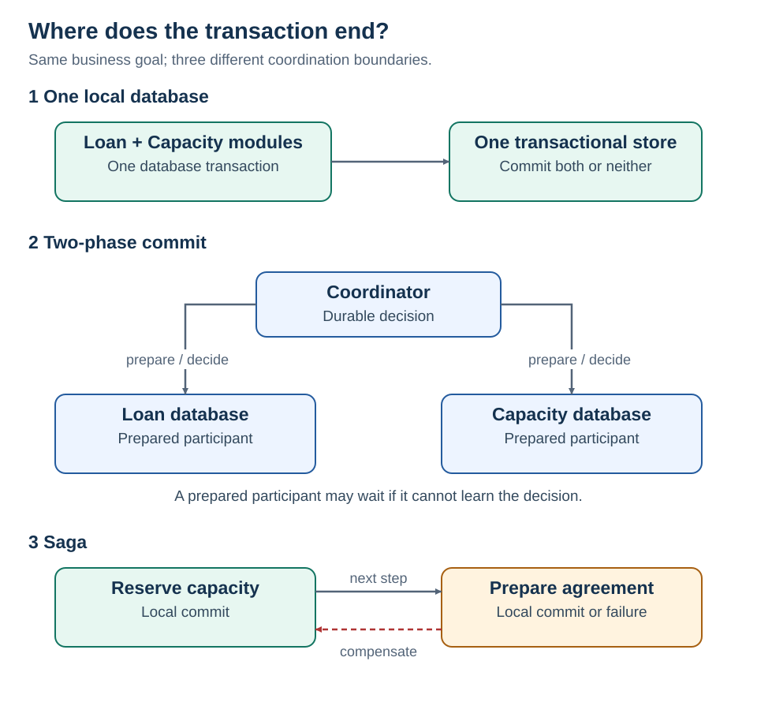

# 1 · Distributed transactions

[Home](README.md) · [Next: event sourcing](02-event-sourcing.md)

**One business action crosses more than one transactional resource. Who decides whether it succeeds?**

Accepting a loan offer updates Loan's database and Capacity's database. A normal transaction in one database cannot roll back a separately committed write in the other.

## Partial failure

1. Capacity reserves 500,000 units and commits.
2. Agreement creation fails.
3. The reservation is still committed. Returning HTTP 500 does not release it.

The architecture needs a recovery rule, not just an exception handler.

| Choice | Guarantee / behavior | Best fit here | Cost |
| --- | --- | --- | --- |
| One local transaction | Atomic writes inside the database's supported boundary | Loan and capacity can share ownership | Shared boundary; scaling and ownership constraints |
| Two-phase commit (2PC) | Coordinated atomic commit across enlisted resources | Short operations, compatible resources, managed transaction coordinator | Prepared resources can hold locks while a decision is unavailable |
| Saga | Local commits plus explicit recovery over time | Independent services and long business workflows | Intermediate states, compensation and recovery logic |

2PC is a real option in systems that support it. It is not universally obsolete, and arbitrary HTTP APIs cannot simply be enlisted. [PostgreSQL prepared transactions](https://www.postgresql.org/docs/current/sql-prepare-transaction.html)

<strong>How 2PC actually works</strong>

**Phase 1 — prepare:** a coordinator asks each participant whether it can commit. A “yes” participant durably prepares; it has promised to obey the final decision.

**Phase 2 — decide:** the coordinator durably records a commit decision once every participant is prepared, then communicates it. If a participant votes no, the transaction aborts. Recovery redelivers the recorded outcome when needed.

**Crash case:** a prepared participant that cannot discover the durable decision cannot safely guess “abort after ten seconds.” Another participant might already have committed. This uncertainty explains classic 2PC blocking.

Atomic commitment is not the same as global serializability or linearizability. Isolation and replication protocols determine additional guarantees. 2PC and consensus solve different coordination problems, although real databases may combine them.

**Protocol boundary:** two phases are protocol rounds, not “write one database, then write another.”

<strong>.NET and enterprise implementation</strong>

For one relational database, EF Core normally wraps one `SaveChanges` call in a transaction when the provider supports transactions. An explicit transaction can group multiple operations. It does not make an HTTP call transactional. Provider, operating system, and deployment support matter for `System.Transactions` and distributed transactions. [EF Core transactions](https://learn.microsoft.com/en-us/ef/core/saving/transactions)

A separate Capacity service is justified only when its ownership or operational requirements warrant the boundary. If it does, use a durable reservation API with an operation ID and a saga. Expose `Pending`, `Active`, and `ManualReview` states instead of claiming immediate all-or-nothing success.

**NoSQL is not synonymous with no ACID.** DynamoDB supports transactional operations within documented boundaries. That does not create a transaction spanning DynamoDB, SQL Server, and an external lender. [DynamoDB transactions](https://docs.aws.amazon.com/amazondynamodb/latest/developerguide/transaction-apis.html)

Operational questions: Who owns the coordinator? Where is its decision stored? How do prepared transactions recover? How long can locks remain? What is the failure recovery procedure?

## Design position

The first choice is the smallest transactional boundary that can enforce the invariant. Supported enlisted resources can use 2PC for atomic commitment, with blocking and recovery costs. Independent services usually need a saga, explicit intermediate states, idempotent operations, and reconciliation rather than a global rollback.

**Boundary:** A timeout does not establish failure: the transaction may have committed before its response was lost.
