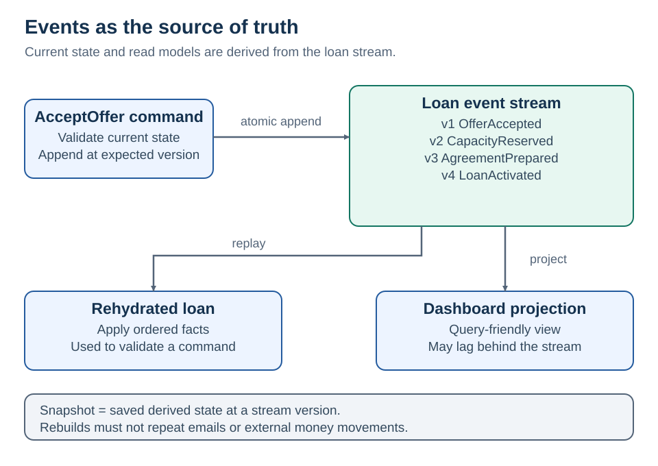

# 2 · Event sourcing

[Home](README.md) · [Next: CDC](03-cdc.md)

**Store the business facts that changed an entity. Derive its current state from those facts.**

Ordinary CRUD might store `Loan.Status = Active`. An event-sourced loan retains the accepted offer, reserved capacity, prepared agreement, and activation facts as its authoritative history.

## Event stream example

| Stream version | Persisted fact | State after applying it |
| --- | --- | --- |
| 1 | `OfferAccepted(OfferId, OfferVersion)` | Accepted |
| 2 | `CapacityReserved(ReservationId)` | Capacity secured |
| 3 | `AgreementPrepared(AgreementId)` | Ready to activate |
| 4 | `LoanActivated(ActivatedAt)` | Active |

The stream belongs to `TenantId + LoanId`. A projection builds a dashboard row from it. A snapshot at version 3 lets the command handler load that state and apply only version 4.

**Snapshots accelerate loading; they do not replace the authoritative history.** [Microsoft event sourcing](https://learn.microsoft.com/en-us/azure/architecture/patterns/event-sourcing)

## Keep these ideas separate

| Idea | What makes it different |
| --- | --- |
| Event-driven architecture | Services react to messages; their databases may still use CRUD |
| Event sourcing | Domain events are the authoritative record for a selected entity |
| Audit log | Supplementary history; the current row may remain authoritative |
| CQRS | Separate write and read models; event sourcing is optional |
| CDC | Capture storage changes; row changes may lack domain intent |

[CQRS reference](https://learn.microsoft.com/en-us/azure/architecture/patterns/cqrs) · [AWS event sourcing](https://docs.aws.amazon.com/prescriptive-guidance/latest/cloud-design-patterns/event-sourcing-pattern.html)

<strong>Concurrent writes and replay</strong>

**Expected version:** two commands load version 3. The first appends version 4. The second must fail its append with expected version 3, reload, and re-evaluate its business rule. Do not silently append both. Enforce stream identity and version uniqueness atomically in the event store.

**Replay:** apply recorded facts to rebuild state or a projection. Replaying `LoanActivated` must not send another welcome email or transfer funds again. Isolate rebuild processors from live side-effect handlers. Historical decisions should use recorded inputs, not today's pricing API. [Fowler: external interactions](https://martinfowler.com/eaaDev/EventSourcing.html)

**Projection recovery:** keep checkpoints; make updates duplicate-safe. If a delta depends on prior facts, process in stream order and detect gaps. Rebuild into a new projection, catch up, validate, then switch readers.

An event broker is not automatically a suitable event store. Required capabilities include durable history, per-stream reads, ordering, concurrency control, and a retention/recovery model that meets the business requirement.

<strong>Is it worth the operational cost?</strong>

Event sourcing is an **optional alternative** for the Loan lifecycle, not a requirement for the whole platform. Start with CRUD plus reliable events unless historical reconstruction has clear value.

Implementation considerations:

- Version the `OfferAccepted` contract so an old offer remains interpretable after pricing rules change.
- Keep personal details in a separately governed profile store; events reference identifiers.
- Record correlation and causation IDs without treating them as authorization.
- Test “given history, when command, then new facts,” plus schema compatibility and rebuilds.
- Measure stream length, replay time, projection lag, and version-conflict rates.

Deleting or encrypting personal information in immutable history requires a retention design with the responsible privacy team; append-only storage is not automatic regulatory compliance.

**When to avoid:** ordinary profile CRUD, small reference tables, or teams that do not need historical reconstruction. Event sourcing adds work to schema evolution, debugging, recovery, and queries.

## Design position

Domain facts are authoritative; current entity state and query projections are derived. Expected-version checks protect appends, while consumers handle duplicates and projection lag. Replay stays separate from external side effects. Adoption is selective and justified by historical reconstruction requirements.

**Boundary:** A current-state row plus `LoanUpdated` notifications is event-driven integration; it is not event sourcing.
