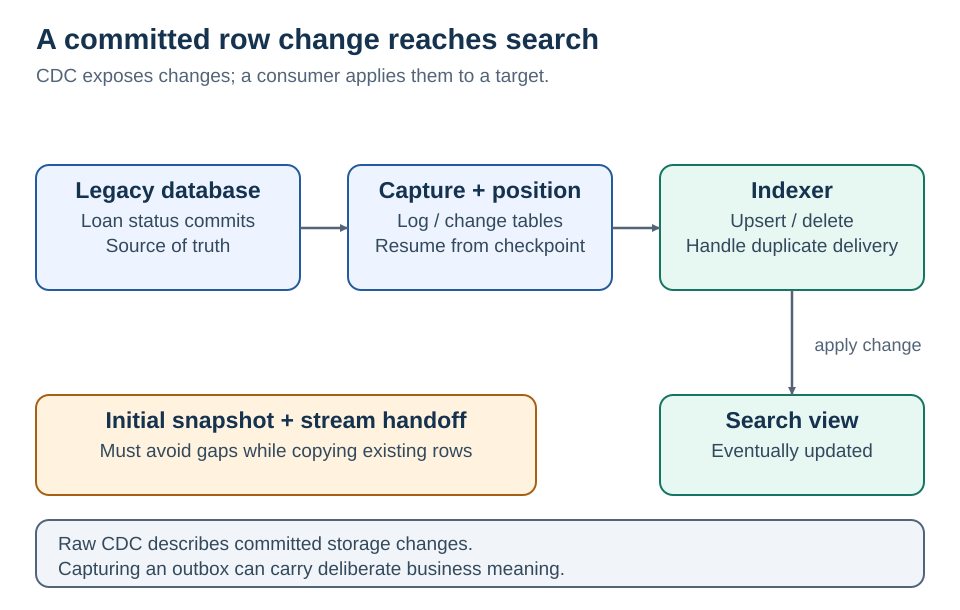

# 3 · Change data capture (CDC)

[Home](README.md) · [Next: sagas](04-sagas.md)

**Follow committed database changes so another system can update its own view.**

the sample loan workflow still has a legacy loan database. Advisers need fast search without adding expensive text searches to the transaction database. CDC feeds an indexer; the database remains authoritative.

## Change propagation

1. A loan status update commits in the legacy database.
2. The capture mechanism exposes the committed change and its position.
3. An indexer applies it to a document keyed by tenant and loan ID.
4. Search becomes current after capture and indexing delays.

SQL Server CDC exposes changes through change tables and query functions. It does not independently push a business event to every subscriber; a consumer or connector supplies the rest of the pipeline. [SQL Server CDC](https://learn.microsoft.com/en-us/sql/relational-databases/track-changes/about-change-data-capture-sql-server)

## CDC is a mechanism; an outbox is a design

| Capture this | Consumer sees | Main tradeoff |
| --- | --- | --- |
| Business table | Column-level changes | Fast legacy integration, but coupled to table structure |
| Outbox table | A deliberately defined event payload | Application change required, but clearer integration contract |

Debezium can capture an outbox table and route its payload into events. **CDC and outbox can be used together.** [Debezium outbox router](https://debezium.io/documentation/reference/stable/transformations/outbox-event-router.html)

<strong>Bootstrap, offsets, and recovery</strong>

An index needs existing rows as well as future changes. Use a connector's supported consistent snapshot-to-stream handoff, or explicitly design and test an equivalent algorithm. “Copy rows, then start listening” can miss writes in between.

Maintain a restart position, such as a database log position and connector offset. If a crash happens after indexing but before the checkpoint is saved, records can be replayed. Use idempotent upserts and handle deletes/tombstones.

Each search document stores its source version. A late version 5 must not overwrite version 6. Enforce this check in the target write; an application-side read-then-write check can race. Version namespaces must survive snapshots, rebuilds, and failover.

When a connector falls behind, retained logs can consume storage. If required changes expire, a restart offset alone cannot recover them: resnapshot or reconcile. Monitor source retention, replication-slot health, lag, and disk usage. [Debezium PostgreSQL connector](https://debezium.io/documentation/reference/stable/connectors/postgresql.html)

<strong>AWS guarantees</strong>

DynamoDB Streams retains changes for up to **24 hours** and orders modifications for an individual item. It is not a permanent event-history store or a global ordering guarantee. [DynamoDB Streams](https://docs.aws.amazon.com/amazondynamodb/latest/developerguide/Streams.html)

A stream record appearing once in the stream does not mean a Lambda handler runs once. Lambda stream processing is at least once; duplicates must be safe. [Lambda with DynamoDB](https://docs.aws.amazon.com/lambda/latest/dg/with-ddb.html)

Example integration policy:

- Use search for discovery, then verify authoritative state before accepting a binding offer.
- Treat deleted rows as explicit removals from search, including tenant-scoped identifiers.
- Keep borrower documents and sensitive fields out of broad capture streams.
- Roll out schema changes with consumer compatibility and monitoring.
- Reconcile source and target counts/versions; a healthy process does not prove correct data.

CDC can reduce invasive changes to a legacy app, but connector privileges, source configuration, load, schema evolution, and recovery still require engineering work.

## Design position

CDC moves committed storage changes into downstream views. The design includes a consistent bootstrap, restart positions, duplicate-safe target writes, deletes, schema evolution, and retention-gap recovery. An outbox provides a deliberate integration contract; search remains a derived view.

**Boundary:** A restart offset is useful only while the required source changes remain available.
