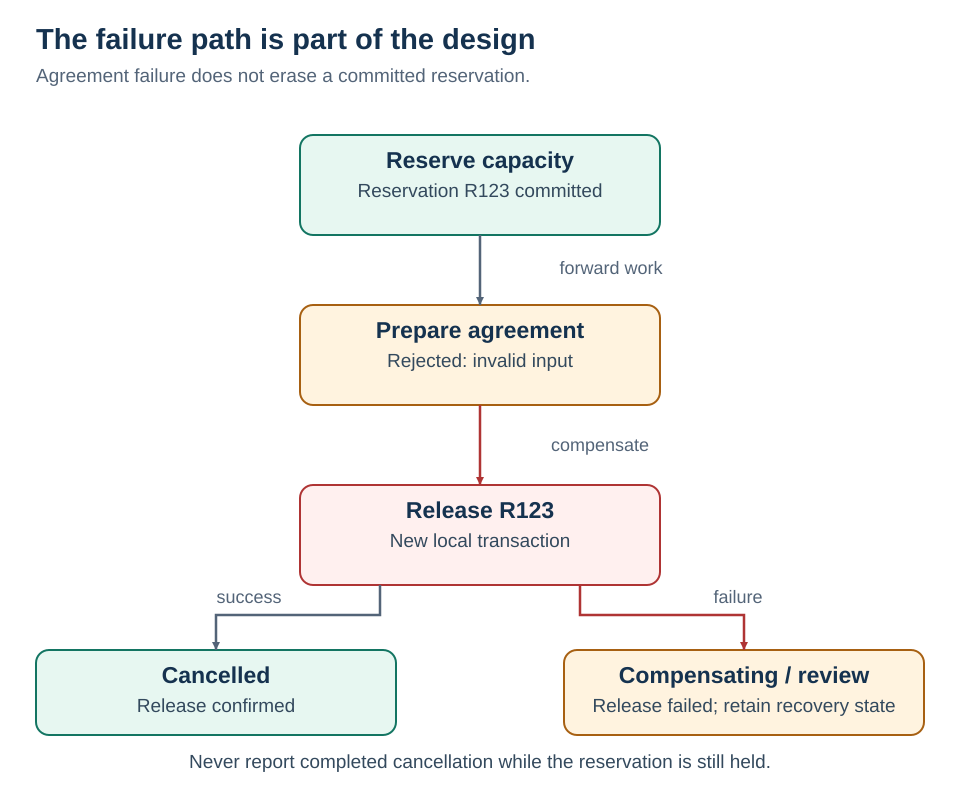

# 4 · Sagas

[Home](README.md) · [Next: coordination](05-coordination.md)

**A saga is a business workflow of local transactions, with a recovery plan for partial completion.**

For this example, `LoanActivated` means the internal application is ready for settlement. It does not mean external money has moved. Keeping that boundary explicit makes recovery easier to reason about.

## What happens if agreement preparation fails?

| Step | Committed work | Recovery in this example |
| --- | --- | --- |
| Reserve capacity | Capacity held for this application | Release this reservation |
| Prepare unsigned agreement | Draft agreement exists | Void this draft |
| Activate loan | Application crosses our chosen business pivot | Finish required downstream work or invoke an explicit servicing process |
| Send welcome | Customer receives a message | Retry if needed; a sent message cannot be unsent |

A pivot is a business decision about a point of no return. It is not a special global database commit.

## Compensation is new work

`ReleaseReservation(R123)` is a fresh transaction. It releases only R123; it does not restore the capacity table to an old snapshot and erase other customers' reservations.

A compensation can fail too. Save recovery progress, retry safe actions, and move unresolved cases into an owned manual-review queue. [Compensating transaction](https://learn.microsoft.com/en-us/azure/architecture/patterns/compensating-transaction)

<strong>Five failure cases to design explicitly</strong>

| Failure | Recovery behavior |
| --- | --- |
| Duplicate reserve command | Same reservation ID returns the existing result; do not deduct again |
| Agreement rejects input | Stop forward progress and release capacity |
| Reserve call times out | Query by operation ID or retry idempotently; outcome is unknown |
| Release fails | Persist `Compensating`; retry or escalate; never pretend cancellation completed |
| Delayed success arrives after cancellation | Apply state/version checks; release a late reservation or reconcile it |

**Isolation:** local ACID transactions do not isolate the whole saga. Concurrent acceptance and cancellation need legal state transitions, concurrency checks, and ownership rules. A reservation may have an expiry and renewal policy; activation must verify it is still valid. [Microsoft saga](https://learn.microsoft.com/en-us/azure/architecture/patterns/saga)

Persist the saga ID, tenant ID, current state, completed step IDs, operation IDs, deadlines, retries, and compensation results. A correlation ID helps find the workflow; it does not deduplicate an operation.

<strong>.NET / AWS mapping</strong>

A durable .NET worker or a workflow engine can coordinate steps. A `try/catch` across HTTP calls in one process is insufficient: process termination can lose the recovery plan.

AWS Step Functions Standard is one candidate for this long-lived flow. Define explicit failure routes and compensation tasks; the service does not invent business compensation for you. [AWS saga orchestration](https://docs.aws.amazon.com/prescriptive-guidance/latest/cloud-design-patterns/saga-orchestration.html)

Workflow execution guarantees do not automatically make an external action exactly once. Explicit retries, duplicated start requests, and a lost provider response still need analysis. Standard, asynchronous Express, and synchronous Express have different execution semantics. [Workflow types](https://docs.aws.amazon.com/step-functions/latest/dg/choosing-workflow-type.html)

Before real settlement, add a provider-supported idempotency key and a status/reconciliation API. Never issue a second transfer merely because the first call timed out. Whether reversal is legally and operationally possible is a separate business contract.

Track the age of pending sagas, compensation failures, reservation expiry, and manual-review backlog. A completed HTTP request is not proof the business workflow completed.

## Design position

A saga coordinates local commits and recovery across a business workflow. Agreement failure releases the specific capacity reservation. Progress is durable, steps and compensations are idempotent, and uncertain outcomes are reconciled. Global isolation is absent; unresolved recovery remains visible in a pending or manual-review state.

**Boundary:** Deleting an email record cannot undo delivery to the customer.
