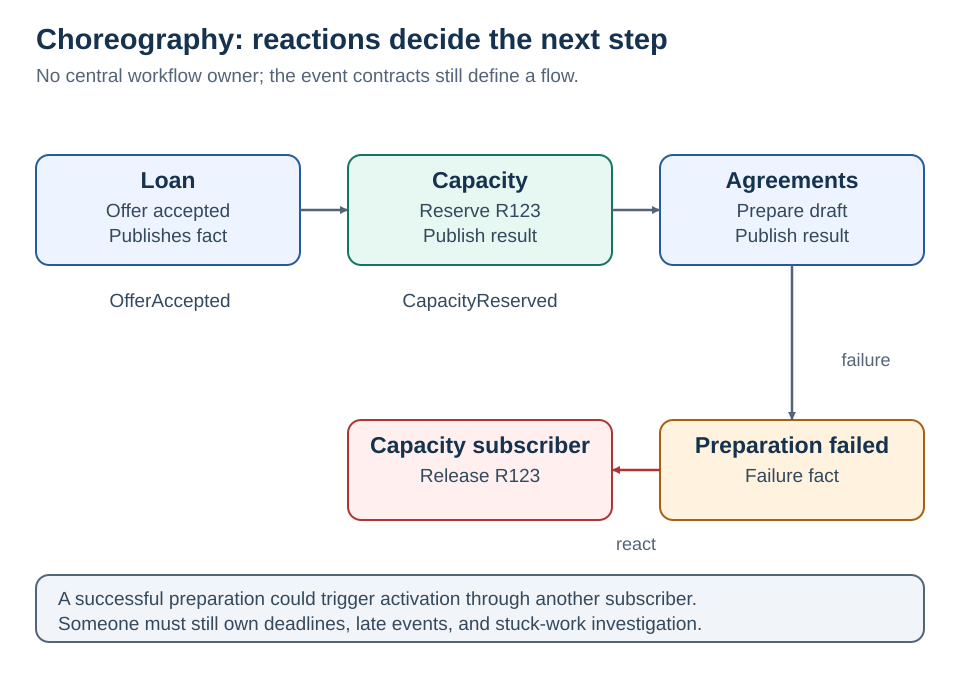
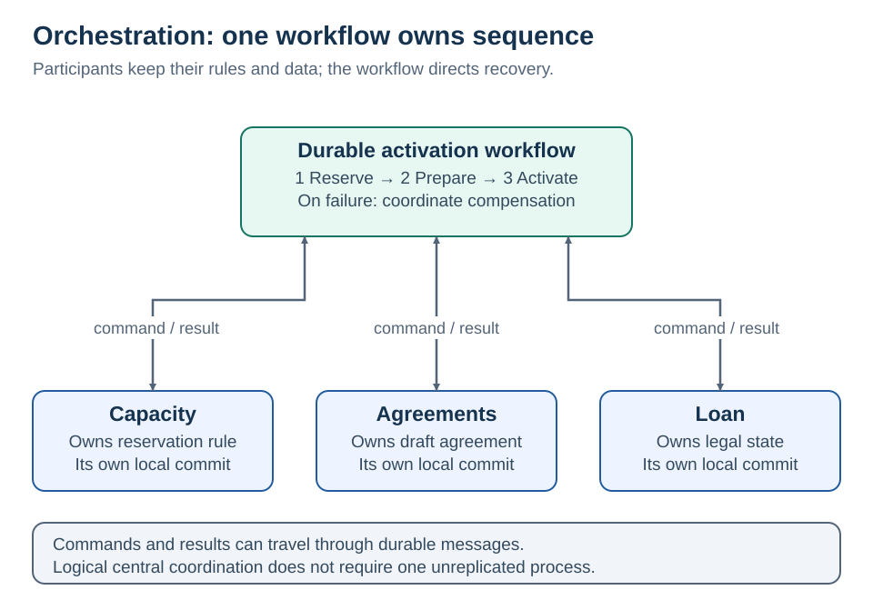

# 5 · Choreography vs orchestration

[Home](README.md) · [Next: CAP](06-cap.md)

**The distinction is who owns the “what happens next?” decision.**

## Choreography: services react to facts

Capacity handles `OfferAccepted`, then emits `CapacityReserved`. Agreements handles that fact. If agreement preparation fails, its failure fact triggers reservation release through a defined subscriber. No central workflow component owns the whole sequence, but the sequence still exists.

## Orchestration: a workflow makes the decisions

The workflow sends commands and handles results. Participants own their data and business rules; the coordinator owns sequence and recovery decisions. An orchestrator may use asynchronous messages—it need not hold open an HTTP request.

| Compare | Choreography | Orchestration |
| --- | --- | --- |
| Next-step logic | Distributed across subscribers | Visible in a workflow |
| Adding an independent subscriber | Usually straightforward | May not need a workflow change if subscribing to published facts |
| Multi-step timeout and recovery | Cross-service contracts must coordinate | Workflow can own deadlines and progress |
| Coupling | Event schema and implicit sequence | Command/result contracts and coordinator |
| Failure investigation | Reconstruct the event path | Inspect workflow history, then participant traces |

Both require durable messaging, idempotency, schema evolution, and operational ownership. [AWS choreography](https://docs.aws.amazon.com/prescriptive-guidance/latest/cloud-design-patterns/saga-choreography.html)

<strong>A practical hybrid</strong>

An **orchestrated activation workflow** is appropriate when capacity expiry, agreement failure, and cancellation require one understandable recovery policy. Publish `LoanActivated` for independent analytics and notification subscribers.

Why a hybrid? Analytics should not need to become a mandatory activation step. A reporting outage should not block a valid activation. If notification is legally required before activation, that is a different business rule and belongs in the coordinated flow.

Commands express an intention directed to an owner. Events express a fact that may interest several subscribers. Do not name a command `LoanActivated` when the receiver can still reject activation.

A coordinator is a logical central decision point, not necessarily one unreplicated process. Replicate and persist its workflow state. Participants must still handle duplicate commands and retain independent authorization checks.

<strong>Coordination tradeoffs</strong>

**“Is choreography loosely coupled?”** It removes direct knowledge of subscribers, but required event sequences and contracts still couple business behavior. A cycle can repeatedly trigger work.

**“Does orchestration make a distributed monolith?”** Not inherently. It becomes problematic when the coordinator owns every participant's business logic or all services must change together. Keep decision boundaries deliberate.

**“Does a saga require orchestration?”** No. A saga can use either style. An event chain without compensation or recovery semantics is not automatically a well-designed saga.

**“What if the orchestrator fails?”** Recover durable workflow state; redeliver outstanding commands safely. Do not reconstruct progress from volatile memory. In Step Functions, evaluate the execution model and explicit retries. [AWS orchestration](https://docs.aws.amazon.com/prescriptive-guidance/latest/cloud-design-patterns/saga-orchestration.html)

## Design position

Required steps with shared deadlines and compensation favor orchestration. Independent reactions favor choreography. Both rely on durable state, versioned contracts, and duplicate-safe participants. The coordinator owns sequence and recovery; each participant retains its domain rules.

**Boundary:** A broker can carry orchestrated commands; broker usage alone does not determine the coordination style.
