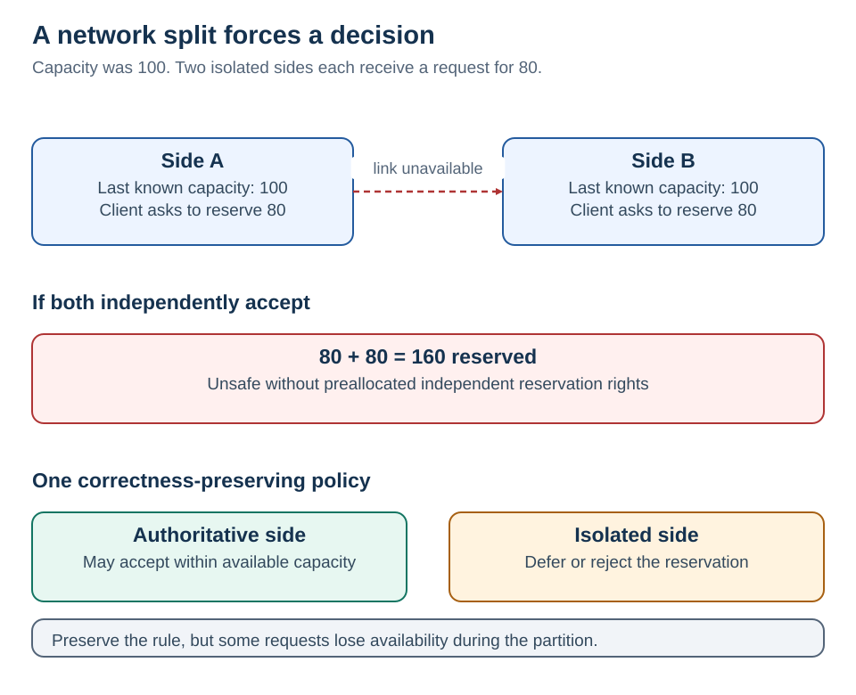

# 6 · CAP theorem

[Home](README.md) · [Next: distributed cache](07-distributed-cache.md)

**When replicas cannot communicate, a system cannot guarantee both linearizable operations and successful responses to every request at every non-failing node.**

The partition is the condition that exposes the conflict. A “CA” label does not remove the possibility of partitions.

## Use the numbers

Both sides last knew available lending capacity was **100**. The network splits. One client asks each side to reserve **80**.

- If both sides independently accept, accepted reservations total **160**. Without preallocated rights, the invariant is broken.
- If only the side with authoritative ownership/quorum may accept, the isolated side rejects or defers. It preserves the chosen correctness rule but sacrifices availability for that operation.

This is an illustrative application of CAP, not a proof that all banking systems have one fixed CAP label. [Gilbert & Lynch, Perspectives on the CAP Theorem](https://groups.csail.mit.edu/tds/papers/Gilbert/Brewer2.pdf)

## Translate the letters accurately

| Term | Interview meaning | Avoid this shortcut |
| --- | --- | --- |
| C — consistency | Linearizable behavior, equivalent to one real-time-respecting copy for the modeled operations | “Every replica is always physically identical” |
| A — availability | Every request at a non-failing node eventually gets a successful response permitted by the modeled service | “99.99% uptime” or returning an error |
| P — partition | Communication can be lost or indefinitely delayed between parts of the system | “A database table partition” |

A rejection may be correct behavior, but it does not satisfy CAP availability for the requested operation. The theorem's availability is not a bounded-latency SLO.

<strong>Choose by operation, not by product slogan</strong>

Example partition policy:

| Operation | Partition behavior we choose | Business reason |
| --- | --- | --- |
| Reserve capacity | Accept only with authoritative ownership; otherwise defer/reject | No over-allocation |
| Browse indicative products | Serve a labeled cached view if policy allows | Staleness is acceptable for discovery |
| Display activation status | Show last known status plus freshness; confirm before action | A stale view must not cause duplicate activation |
| Edit a draft note | Consider offline capture with an explicit conflict policy | A merge may be acceptable |

A queued request marked `Pending` is not a successful reservation. Asynchronous acceptance changes the API contract; it does not evade CAP.

Advanced alternative: preallocate independent reservation rights to regions. Each can accept only within its own rights during isolation. That can preserve the invariant for bounded operations, but sacrifices flexibility and requires safe rights transfer. It is a different coordination design, not unlimited availability.

<strong>CAP does not answer every consistency question</strong>

Atomicity asks whether a set of writes commits together. Isolation asks how concurrent transactions interact. Linearizability asks whether operations respect real-time order. Eventual consistency describes convergence. The required property needs to be stated explicitly.

Outside partitions, latency and coordination still matter. PACELC is a useful additional lens: during a partition, consider availability versus consistency; otherwise, consider latency versus consistency. It is not a replacement for a concrete workload and database guarantee. [Abadi: PACELC](https://www.cs.umd.edu/~abadi/papers/abadi-pacelc.pdf)

Do not assign all Redis deployments the same consistency label. Redis Cluster documents asynchronous replication and possible loss of acknowledged writes under failures. A shared cache is not automatically an authoritative financial store; the deployment guarantee matters. [Redis Cluster specification](https://redis.io/docs/latest/operate/oss_and_stack/reference/cluster-spec/)

A partition policy records the failure, affected operation, chosen outcome, and client recovery behavior. A CP/AP abbreviation alone does not capture these decisions.

## Design position

Partition behavior is defined per operation. Capacity reservation requires authoritative coordination; affected requests defer when coordination is unavailable. Product browsing can tolerate a labeled stale view. Queued acceptance changes the API contract but does not complete the underlying reservation.

**Boundary:** A 503 response from an isolated replica does not satisfy CAP availability for the requested operation.
