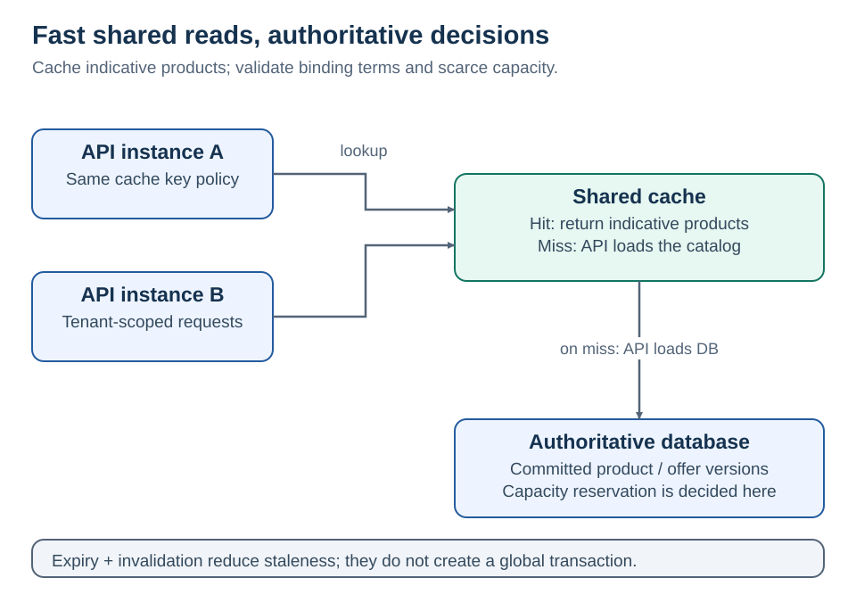

# 7 · Distributed cache

[Home](README.md) · [Next: connected enterprise scenario](08-enterprise-scenario.md)

**Several app instances share a cache so repeated reads can avoid expensive authoritative work.**

“Distributed” does not necessarily mean a full copy beside every server. The cache may be an external shared service with shards and replicas; the network hop still exists.

## Cache-aside flow

1. The API checks `tenant:T1:products:v3`.
2. On a hit, return the cached indicative product list.
3. On a miss, read the authoritative catalog, cache the result with an expiry, and return it.
4. On a catalog update, commit the database change, then invalidate or update the cache according to policy.

Cache-aside does **not** guarantee the cache always matches the database. [Cache-aside pattern](https://learn.microsoft.com/en-us/azure/architecture/patterns/cache-aside)

## Cache policy by data type

| Data | Example policy | Why |
| --- | --- | --- |
| Indicative product list | Cache briefly; show freshness where useful | Some staleness acceptable |
| Binding offer | Use a versioned authoritative offer and validate acceptance | Wrong terms have business consequences |
| Available lending capacity | Cached value may inform a display; authoritative conditional write decides | Stale reads cannot allocate scarce capacity |
| Permissions / tenant access | Enforce current authorization policy; cache only with deliberate revocation rules | A key naming convention is not access control |

<strong>The invalidation race</strong>

Even “write database, then delete cache” has a race:

| Time | Reader | Writer |
| --- | --- | --- |
| 1 | Cache miss; reads old product version 5 | |
| 2 | Pauses before filling cache | Commits version 6 |
| 3 | | Deletes cached product key |
| 4 | Writes version 5 into the empty cache | |

For indicative data, choose a bounded absolute TTL and document the tolerated stale interval. TTL bounds the life of that stale entry after fill; it is not a strong-consistency guarantee. Sliding expiry alone can keep a frequently accessed stale value alive.

For stricter reads, bypass the cache or design a coordinated version/fencing strategy. Merely checking a cached version outside the target write is another race. A reliable invalidation event helps recover from lost invalidation, but does not automatically solve every concurrent stale fill.

<strong>Common failure patterns</strong>

| Problem | Symptom | Possible response |
| --- | --- | --- |
| Stampede | Many misses load the same expensive data | Coalesce loads; assess coordination across instances |
| Synchronized expiry | Many keys expire together | Add bounded TTL jitter |
| Hot key | One product dominates traffic | Measure load; consider a small L1 cache with explicit staleness |
| Penetration | Repeated requests for missing records | Brief negative caching where safe; validation and rate limits |
| Cache outage | Every API falls back to the database | Short cache deadlines, bounded fallback concurrency, load shedding |
| Wrong tenant key | One tenant's data appears in another's response | Trusted tenant scoping plus authorization on every path |

**Fail open or closed?** An indicative catalog may fall back to the database. A security decision may need to reject when freshness cannot be established. Base the decision on the data's contract.

**Write-through** updates the cache through a write path. **Write-behind** defers storage writes and requires a loss/recovery design. **Cache-aside** lets the app coordinate cache and storage. Names alone do not define atomicity.

ASP.NET Core's `IDistributedCache` abstracts cache access. It does not provide a database transaction, a cross-instance lock, or automatic correctness. Redis is one provider. [ASP.NET Core distributed caching](https://learn.microsoft.com/en-us/aspnet/core/performance/caching/distributed)

Measure hit ratio alongside p95/p99 latency, cache timeouts, evictions, stale-age samples, database fallback load, and key cardinality. A high hit ratio with wrong data is failure.

## Design position

Cache-aside suits indicative catalog reads with tenant-scoped keys, absolute expiry, and invalidation after committed changes. The design accounts for stale fills, stampedes, and database load during cache failure. Binding offer acceptance validates authoritative versioned data.

**Boundary:** A shared remote cache retains a network hop; its benefit comes from avoiding more expensive authoritative work.
