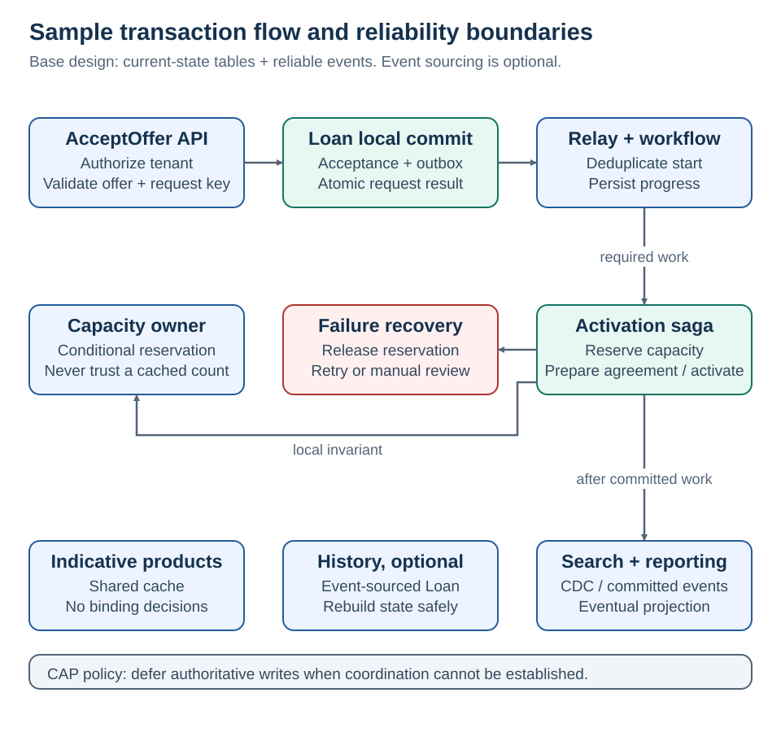

# Combined example · loan acceptance

[Home](README.md) · [Reliability companions](09-reliability-companions.md)

**The goal: accept a valid offer without over-reserving capacity, and recover if later work fails.**

The example combines offer acceptance, capacity reservation, agreement preparation, and activation across separate data owners.

## Requirements before products

| Requirement | Design implication |
| --- | --- |
| No negative lending capacity | Atomic conditional reservation in the owning store |
| Same acceptance retry creates one workflow | Tenant-scoped idempotency record and stable operation ID |
| Agreement failure must release capacity | Saga compensation with durable progress |
| Dashboard may lag up to 5 seconds under normal operation | Async projection with measured lag and a freshness indicator |
| Binding terms must be the accepted version | Store and validate immutable offer ID/version and validity |
| Adviser belongs to one or more authorized tenants | Server-derived tenant context and per-operation authorization |
| No invisible stuck work | Deadlines, reconciliation, alerts, and an assigned operations owner |

These requirements define the example; they are not measured production guarantees.

## Acceptance flow

1. **API receives `AcceptOffer`.** Validate authenticated tenant, permissions, offer version/expiry, and request key. Atomically save acceptance, idempotency result, and outbox event. Return `202 Accepted` with an operation/status URL; this means queued work, not an active loan.
2. **Outbox relay publishes the accepted fact.** Retry safely if publication is uncertain. A duplicate event must map to the same durable workflow, not a second reservation.
3. **Workflow reserves capacity.** Capacity owns its invariant and reservation ID. Commit reservation, conditional decrement, and resulting event locally.
4. **Workflow prepares the unsigned agreement.** On definitive failure, release the reservation and record cancellation. On a timeout, resolve the agreement operation's outcome before assuming failure.
5. **Workflow activates.** Confirm the reservation and agreement remain valid. Persist the legal state transition with concurrency protection. Reject or reconcile racing cancellation.
6. **Independent consumers react.** Update dashboard/search; send allowed notifications. Failed analytics does not undo an otherwise valid activation.

The base design uses current-state tables plus an outbox. **Optional event-sourced variant:** replace the Loan write model with an authoritative event stream only if reconstruction is required. Publish from a durable mechanism tied to the event append; do not add an unprotected second write.

## Why each concept appears

| Concept | Its exact job here | What it does not solve |
| --- | --- | --- |
| Distributed transaction reasoning | Identify the Loan / Capacity / Agreements boundaries | Does not choose the recovery business rules |
| Saga | Drive activation and compensation | Does not make all intermediate states invisible |
| Orchestration | Own required sequence, deadlines and recovery | Does not own participants' internal rules |
| Outbox + inbox | Connect committed changes to eventual processing, safely under retries | Does not atomically include an external lender API |
| Event sourcing, optional | Reconstruct Loan history | Does not replace message delivery or backups |
| CDC | Feed search from legacy data, or relay an outbox | Does not infer every business intention from rows |
| CAP analysis | Define behavior under lost coordination | Does not prescribe one label for the whole platform |
| Cache | Speed indicative catalog reads | Does not authorize binding acceptance |

## Concrete technology mapping

| Responsibility | .NET / SQL option | AWS option to evaluate |
| --- | --- | --- |
| Command API | ASP.NET Core + EF Core | API Gateway with Lambda, or containerized .NET |
| Authoritative transactional data | SQL Server or PostgreSQL | RDS/Aurora; or DynamoDB with a different data model |
| Durable workflow | Persisted .NET workflow/worker | Step Functions Standard |
| Messaging | Broker plus durable consumers | SQS; EventBridge for routing where appropriate |
| Relay | Outbox polling worker or CDC connector | Worker service; CDC/stream pipeline suited to the source |
| Search projection | Indexing worker | OpenSearch with duplicate/version-safe indexing |
| Shared cache | Redis provider | ElastiCache, sized and configured for the workload |
| Observability | OpenTelemetry traces + structured metrics | CloudWatch and trace export |

These mappings depend on service support, delivery semantics, quotas, cost, and recovery contracts; the products are not interchangeable APIs.

<strong>Capacity planning and operations</strong>

**Hypothetical load:** 100,000 acceptance attempts/day is about 1.16/second on average. A 100× burst is about 116/second. If each attempt creates five messages, the burst is approximately 580 messages/second before retries. Reads, document processing, hot tenants, and retry storms need separate estimates.

Use measurements to set budgets. Example targets to validate: status reads p95 under 200 ms, normal projection lag under 5 s, and an alert when pending activations exceed their agreed workflow deadline. Do not hide long business workflows behind a short HTTP latency SLO.

**Tenant isolation:** tenant ID comes from trusted authentication/authorization context. Scope database keys, unique constraints, message validation, and caches. RLS can add defense in depth but requires deliberate session/context management. A message field from another service is not enough to authorize a cross-tenant action.

**Recovery:** test backup restoration, workflow-state recovery, replay without external side effects, and reconciliation of active reservations against workflow state. An outbox cannot recover data already lost outside the storage durability model.

**Security:** use least-privilege service identities, protected transport/storage, restricted borrower-document access, and redacted telemetry. Preserve only the business evidence required by the agreed retention policy.

## Architectural position

A modular monolith is sufficient when the invariant fits one database. Independent service boundaries introduce a need for durable orchestration, local invariant enforcement, and reliable event delivery. Search and indicative catalogs may lag; reservation and offer validation use authoritative state.