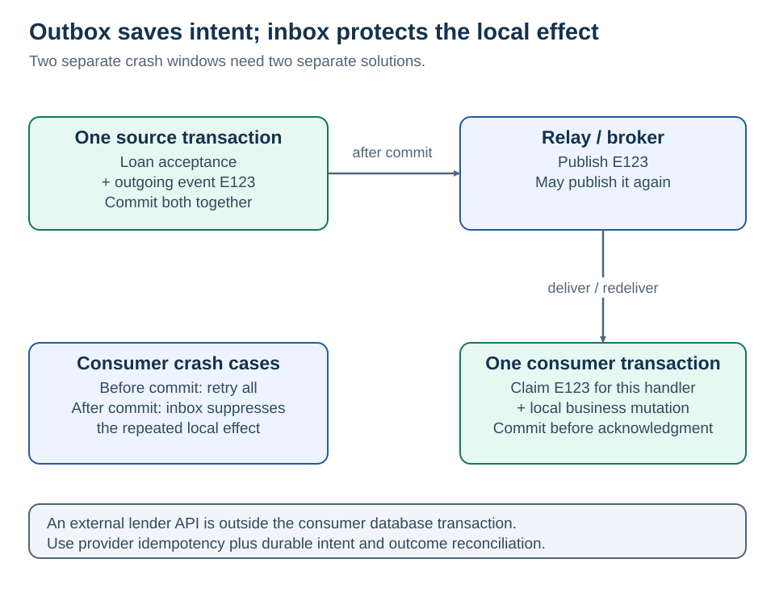

# The supporting patterns that make the seven useful

[Home](README.md) · [Design questions](10-design-questions.md)

**A saga needs reliable steps. Reliable steps need durable intent and safe retries.**



## 1 · Transactional outbox: do not lose the intent

Save the business change and its event record in **one local database transaction**. A separate relay publishes committed records. If the process dies after commit, the event record remains available to the relay.

If the relay publishes and dies before marking a record sent, it may publish again. The outbox closes the database/broker dual-write gap; it does not guarantee exactly-once delivery. [AWS outbox](https://docs.aws.amazon.com/prescriptive-guidance/latest/cloud-design-patterns/transactional-outbox.html)

**Illustrative EF Core sketch — not a complete runnable application:**

```csharp
// Both entities use the same DbContext and transactional database.
loan.Accept(offerVersion);
db.OutboxMessages.Add(new OutboxMessage(eventId, tenantId, loan.Id,
    loan.Version, "OfferAccepted", payload));
await db.SaveChangesAsync(ct); // One local commit with a supported provider.
// A durable relay publishes later; do not publish directly as a second write.
```

The actual API also needs a unique request key and an atomically stored idempotency result. Outbox schema should carry a stable event ID, tenant, aggregate identity/version, type/schema version, payload, and creation time. Relay retry/lease state depends on polling vs CDC.

## 2 · Inbox and idempotency: do not repeat the effect

An inbox records which events a specific handler has processed. In the **same transaction**, claim the message ID and apply its local mutation. A unique constraint arbitrates concurrent delivery.

**Conceptual transaction algorithm:**

```text
BEGIN
  INSERT ProcessedMessages(TenantId, ConsumerName, EventId)
  -- Unique conflict: abort this attempt and treat as already processed.
  APPLY local business change
  INSERT outgoing event if needed
COMMIT
ACK incoming message only after commit
```

Writing the marker before an external effect can lose the effect; writing it afterward can duplicate the effect. For external calls, use a durable outgoing intent, a stable provider idempotency key, and reconciliation of unknown outcomes. [Idempotent APIs](https://aws.amazon.com/builders-library/making-retries-safe-with-idempotent-APIs/)

Design request keys around business intent: `(TenantId, Operation, ClientKey)`. Keep a payload fingerprint; reject the same key with different inputs. Define retention relative to the full retry/redrive window. Expiring a dedup record can make an old retry new work.

## 3 · Ordering and concurrency: deduplication is not sequence control

`AgreementPrepared v3` arriving before `CapacityReserved v2` can break a delta-based projection even when neither is a duplicate. Partition related events by aggregate, track sequence/checkpoints, and handle gaps according to the contract. A timestamp alone is not a global ordering protocol.

A complete-state projection may safely ignore older versions with an atomic conditional write. An event that increments a balance cannot simply discard missing predecessors. For concurrent database commands, use conditional writes or optimistic concurrency and re-evaluate rules after conflicts. [EF Core concurrency](https://learn.microsoft.com/en-us/ef/core/saving/concurrency)

## 4 · Timeouts, retries, dead letters

| Tool | Use | Avoid |
| --- | --- | --- |
| Timeout | Bound waiting and resource consumption | Interpreting timeout as proof of failure |
| Backoff + jitter | Spread retry load | Every client retrying at once |
| Retry budget | Bound attempts and end-to-end duration | Multiplying retries at every service layer |
| Circuit breaker | Temporarily stop calls to a repeatedly failing dependency | Assuming it repairs that dependency |
| Bulkhead / concurrency limit | Keep one slow dependency from exhausting the app | Unlimited fallback to the database |
| Dead-letter queue | Isolate repeatedly failing messages for investigation | Treating it as successful completion |

Retry transient failures when the operation is safe to retry. Business rejection normally needs a new decision, not the same request repeated forever. [AWS backoff and jitter](https://aws.amazon.com/builders-library/timeouts-retries-and-backoff-with-jitter/)

For SQS, receiving a message is not deletion. Visibility timeout temporarily hides it; handlers can still see duplicates. A crash after commit but before delete is why local effects need idempotency. [SQS visibility](https://docs.aws.amazon.com/AWSSimpleQueueService/latest/SQSDeveloperGuide/sqs-visibility-timeout.html) · [At-least-once delivery](https://docs.aws.amazon.com/AWSSimpleQueueService/latest/SQSDeveloperGuide/standard-queues-at-least-once-delivery.html)

A dead-letter procedure needs an alarm, owner, diagnosis, fix, and controlled redrive. Reuse the original business identity; generating a new ID can bypass deduplication. [SQS DLQs](https://docs.aws.amazon.com/AWSSimpleQueueService/latest/SQSDeveloperGuide/sqs-dead-letter-queues.html)

## 5 · Observe the business outcome

Log `TenantId`, `LoanId`, `SagaId`, `OperationId`, `EventId`, and a trace ID where permitted. Keep sensitive payloads out of logs. Count duplicate suppression and out-of-order events; measure outbox age, consumer lag, compensation failures, and unresolved operations. A trace is a diagnostic aid, not the durable workflow state.

