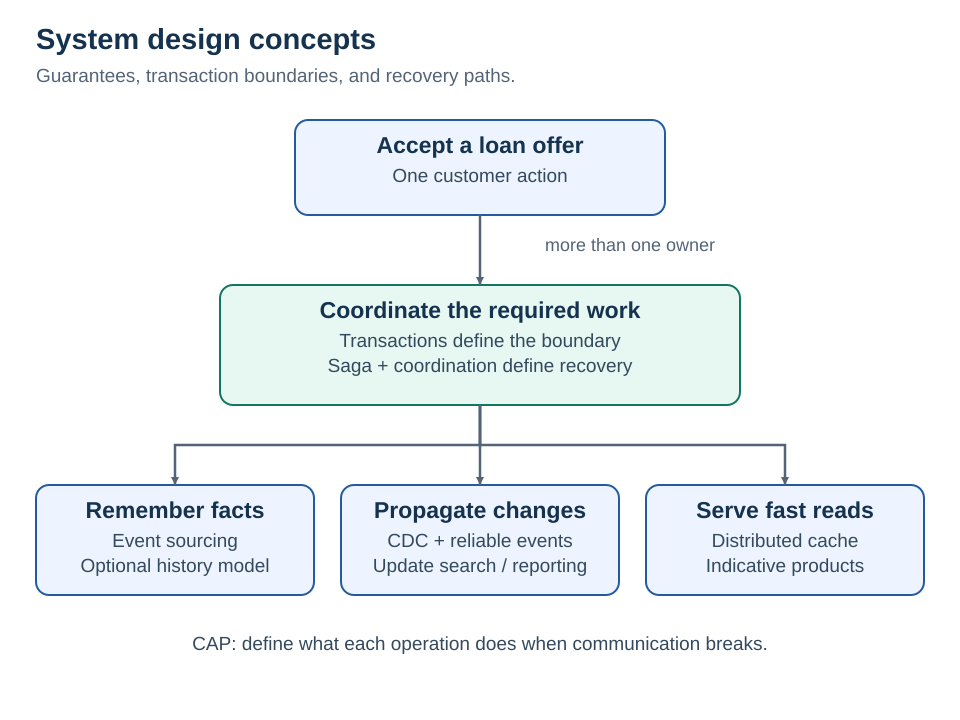

# Enterprise system design notes

Notes on consistency, coordination, event-driven integration, and caching. Each concept records the guarantee, failure boundary, tradeoffs, and a concrete example.

## Concepts

| Concern | Notes | Example |
| --- | --- | --- |
| Atomic work across resources | [Distributed transactions](01-distributed-transactions.md) | A capacity reservation commits before agreement creation fails |
| Authoritative business history | [Event sourcing](02-event-sourcing.md) | Derive loan state from persisted domain facts |
| Propagating committed changes | [Change data capture](03-cdc.md) | Update search from a transaction database |
| Recovering partial completion | [Sagas](04-sagas.md) | Release a specific reservation after a later step fails |
| Owning the next-step decision | [Choreography and orchestration](05-coordination.md) | Coordinate activation; publish facts for independent consumers |
| Behavior under lost communication | [CAP theorem](06-cap.md) | Defer reservation when authoritative coordination is unavailable |
| Shared fast reads | [Distributed caching](07-distributed-cache.md) | Cache indicative products; validate binding decisions at the source |

## Related notes

[Foundations](00-foundations.md) · [Combined loan acceptance example](08-enterprise-scenario.md) · [Reliability patterns](09-reliability-companions.md) · [Design questions](10-design-questions.md) · [Glossary](12-glossary.md)

[Documented enterprise implementations](13-real-enterprise-examples.md) connect these concerns to published engineering reports. The [source register](11-research-register.md) links the underlying documentation and papers.

## Working principles

- Keep invariants inside the smallest practical transactional boundary.
- Treat timeouts as uncertain outcomes until resolved.
- Model compensation as new business work, with its own failure path.
- Separate authoritative state from caches, search indexes, and projections.
- Evaluate guarantees per operation and failure mode.

## Repository

Numbered Markdown files contain the notes. SVGs provide the rendered diagrams, with matching Mermaid definitions alongside them. `FAILURE_MODELS.md` documents the deterministic examples in `test_failures.py`.

The offline reference is `START_HERE.html`; download the repository and open it locally. Validation and rebuild commands are listed in [CONTRIBUTING.md](CONTRIBUTING.md).
